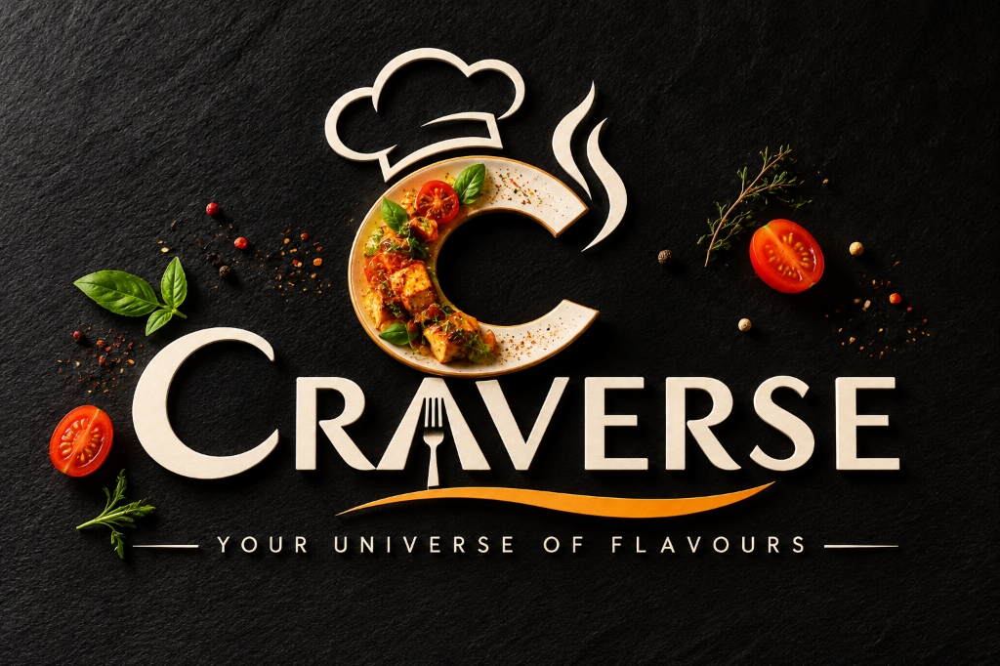

# Craverse | Your Universe of Flavours
> **Tagline:** *Your Universe of Flavours.*  
> **Concept:** 100% Pure Vegetarian Digital Dine-in & Restaurant Operations Platform with Glassmorphic 3x3 Food Grid, Zero GST, Integrated UPI Payments, and Dedicated Staff Consoles.

<p align="center">
  
</p>

Craverse connects seamless customer QR dine-in ordering, live kitchen displays, waiter floor service, cashier POS billing, inventory management, and multi-tenant restaurant administration into one unified ecosystem.

---

## 🌟 Highlights & Core Features

### 1. 100% Pure Vegetarian & Curated Menu
- **Strictly Pure Veg**: Certified vegetarian menu with authentic green dot badges (`foodType: 'veg'`).
- **Focus Categories**:
  - **Artisan Pizzas**: Hand-stretched thin crusts (Margherita, Farmhouse Veggie, Paneer Tikka, Peri-Peri Corn).
  - **Snacks & Starters**: Cheesy Garlic Breadsticks, Peri-Peri Loaded Fries, Crispy Corn, Spring Rolls.
  - **Comforting Rice Bowls**: Paneer Butter Masala Bowl, Dal Makhani Rice, Veg Biryani.
  - **Coffees & Lattes**: Freshly brewed Espresso, Hazelnut Cappuccino, Spanish Iced Latte, Cold Coffee with Ice Cream.
  - **Chilled Drinks**: Fresh Mint Mojito, Peach Ice Tea, Blue Curacao Fizz, Alphonso Mango Cooler.
  - *(Zero alcohol / Zero meat items across the entire platform)*.
- **Fair & Reasonable Pricing**: All food items and beverages are reasonably priced under ₹350.

### 2. Modern Glassmorphic 3x3 Grid UI & Dual Theme
- **Glassmorphism**: Frosted glass cards (`glass-card`, `glass-badge`) with ambient background glows.
- **Responsive 3x3 Grid**: 3 columns on desktop, 2 columns on small tablets, and 1 column on mobile phones.
- **Dark & Light Mode**: Instant toggle in the header with persistent state (`craverse_theme`), zero-flash bootstrap script, and full dark styling across Customer, KDS, POS, Waiter, and Admin portals.

### 3. Transparent Zero-GST Billing
- **Zero GST Policy**: 0% CGST, 0% SGST, and 0% Service Charge.
- **Net Payable**: Exactly equals `Subtotal - Discounts`. No hidden fees or surprise taxes.
- **Coupons Engine**: Built-in instant discount codes (`WELCOME10`, `PIZZA20`, `FLAT30`).

### 4. Mandatory Guest Verification
- **Required Details**: Full Name (min. 2 characters) and Mobile Number (valid 10-digit with `+91` prefix) are mandatory before placing orders or settling bills.
- **Smart Persistence**: Guest details are remembered in `localStorage` (`craverse_guest_name`, `craverse_guest_phone`) for seamless subsequent orders at the table.
- **Portal Visibility**: Guest contact information is prominently displayed on Kitchen KDS tickets, Waiter Hub table drawers, Cashier bills, and Thermal receipts.

### 5. Instant UPI QR Payment & Merged User Settlement
- **Zero Waiting Checkout**: Embedded UPI Scan & Pay directly inside the customer cart drawer and bill summary.
- **Dynamic UPI QR**: Standard `upi://pay` generation with VPA (`craverse.cafe@okhdfcbank`), payee name, and dynamic order total. Compatible with Google Pay, PhonePe, and Paytm.
- **Pay at Table Option**: Request cash or card settlement directly to seated staff.

### 6. Two-Way Order Cancellation
- **Customer Cancellation**: Diners can cancel their order batches directly from the live progress tracker before food preparation begins.
- **Kitchen KDS Cancellation**: Chefs can cancel tickets with pre-set cancellation reasons (*Out of ingredients*, *Kitchen overloaded*, *Customer request*).
- **Audio Chime**: Web Audio API descending chime alert notifies staff immediately of cancelled orders.

### 7. Unified & Dedicated Portals
- **Customer Dine-in View** (`/` or `?table=16`): QR menu, customization modal, cart drawer, live order tracking, waiter calling, and UPI payments.
- **Kitchen Display System (KDS)**: Live tickets, urgent preparation timer color badges, station filters (*Snacks, Pizza, Rice, Beverages*), and sound notifications.
- **Waiter Floor Hub**: Table occupancy matrix, table assistance notifications (*Water, Cutlery, Clean Table, Printed Bill*), and quick order punching.
- **Cashier POS**: Open table bills, multi-tender settlement (*UPI, Cash, Card, Sandbox PG*), and 80mm printable thermal receipt generator with logo.
- **Admin & Multi-Tenant Console**: Merged administrative controls for Menu CRUD, Floor QR management, Inventory tracking, Staff accounts, Recharts revenue analytics, and Multi-Brand tenant management.

---

## 🛠️ Technology Stack

| Layer | Technologies |
|:---|:---|
| **Frontend Framework** | React 18, TypeScript 5 |
| **Styling** | Tailwind CSS 3 (Glassmorphism, custom scrollbars, animations) |
| **Bundler & Dev Server** | Vite 6 (HMR, tree-shaking, production optimization) |
| **Icons & Visuals** | Lucide React, Canvas Confetti |
| **QR Code Engine** | QRCode (`qrcode` npm library) |
| **Audio Synthesizer** | Native Web Audio API (ambient kitchen chimes and cancellation alert) |
| **Charts & BI** | Recharts (Area, Bar, and Pie Charts) |
| **Test Runner** | Node.js Test Runner (`node:test`, `node:assert`, `--experimental-strip-types`) |

---

## 🧪 Testing & Mobile Responsiveness

### Automated Test Suite (17 Tests • 100% Passing)
Run the automated test suite with:
```bash
npm test
```

Tests cover:
- **100% Pure Veg & Alcohol-Free Integrity**: Asserts all items are vegetarian and verifies the absence of non-veg/alcohol terms.
- **Zero GST & Billing**: Verifies 0% tax math (`totalAmount === subtotal - discount`) and coupon application.
- **Guest Name & Phone Validation**: Enforces mandatory full name and valid 10-digit mobile number rules.
- **QR Code & Dynamic UPI Data URLs**: Validates base64 PNG data URL generation for table onboarding and payments.
- **Currency & Time Formatting**: Tests Indian Rupee formatting (`₹`) and relative elapsed time strings.
- **Order Cancellation**: Validates order state transitions, cancellation reasons, and audit logging.

### Mobile Responsiveness
- **Adaptive Grid**: 3x3 layout on desktop seamlessly reflows into 1 column on phones and 2 columns on small tablets.
- **Mobile Drawers & Sheets**: Cart drawer uses full-width bounds (`pl-0 sm:pl-10`) on phones. Modals render as mobile-native bottom sheets (`items-end`, `rounded-t-3xl`).
- **Touch-Friendly Targets**: Horizontal swipeable category tabs (`no-scrollbar`), comfortable button heights, and floating cart bar with `pb-36` page offset to prevent content obscuration.

---

## 🚀 Getting Started

### 1. Prerequisites
- **Node.js**: v18+ (verified on Node.js v24)
- **Package Manager**: npm

### 2. Installation
```bash
# Clone the repository
git clone https://github.com/your-username/craverse.git
cd craverse

# Install dependencies
npm install

# Start Vite development server
npm run dev
```

The application runs on `http://localhost:3000/`.

### 3. QR Dine-in Simulation
Simulate a customer scanning Table 16's QR code:
```
http://localhost:3000/?table=16&token=t06psez9ig_16
```
Or switch portals and tables using the top navigation bar or the lock icon in the customer header.

### 4. Build for Production
```bash
# TypeScript verification & production build
npm run build

# Preview production build locally
npm run preview
```

---

## 🔒 Optional Cloud Synchronization (Firebase)
Craverse functions fully out-of-the-box with persistent local storage. To sync with a live Google Cloud Firebase backend, configure `.env`:
```env
VITE_FIREBASE_API_KEY=your_api_key
VITE_FIREBASE_AUTH_DOMAIN=your_project.firebaseapp.com
VITE_FIREBASE_PROJECT_ID=your_project_id
VITE_FIREBASE_STORAGE_BUCKET=your_project.appspot.com
VITE_FIREBASE_MESSAGING_SENDER_ID=your_sender_id
VITE_FIREBASE_APP_ID=your_app_id
```
*(Or input credentials dynamically via **Admin Console ➔ Settings ➔ Cloud Sync**).*

---

## 📄 License
MIT License. Built for Craverse Dining & Operations Platform.
